# 🏫 Campus Complaint Tracking System

A complete, role-based desktop application built with **Java Swing** and **File I/O** to streamline complaint management in universities.

---

## 📌 Overview

Manual complaint handling in universities—paper forms, emails, and office visits—often leads to lost requests, delays, and poor transparency.

**Campus Complaint Tracking System** solves this with a centralized, automated platform that tracks complaints from submission to resolution. Built with clean OOP principles, it supports five user roles, automatic resolver assignment, priority-based deadlines, and real-time notifications.

---

## ✨ Features

### 🔹 User Management
- **5 User Roles** – Students, Professors, Staff, Managers, and Resolvers each have dedicated dashboards with tailored permissions.
- **Role‑based Dashboards** – After login, users see only the tools relevant to their role – complainants submit/view complaints, resolvers manage tasks, managers oversee the entire system.

### 🔹 Complaint Lifecycle
- **5 Complaint Categories** – Academic, Administrative, IT, Infrastructure, and Library. Each category has its own set of issue types and point weights.
- **Priority & Deadline Calculation** – Priority = `Urgency (1–5)` + `Issue Points (3–15)`. Mapped to deadlines from 7 days down to **1 hour** for critical issues (e.g., fire hazard).
- **Sequential Status Updates** – Resolvers follow a strict sequence: **25% → 50% → 75% → 100%** – no skipping steps, ensuring thorough processing.

### 🔹 Automation & Intelligence
- **Auto‑Assignment** – The system automatically finds the best resolver based on **category expertise** and **current workload** (fewest pending complaints). Flagged resolvers are excluded.

### 🔹 Feedback & Accountability
- **Feedback System** – Complainants rate satisfaction on a **0–100% slider**. Average feedback appears in manager reports.
- **File‑based Notifications** – Every status change, query, or reassignment triggers a notification saved to `notifications.txt` – users see them in a dedicated panel.

### 🔹 Manager Oversight
- **Manager Reports & Analytics** – View statistics per category (submitted, resolved, feedback) and a resolver performance dashboard (average resolution time & feedback).
- **Query & Reassign** – Send queries to resolvers for overdue complaints; view resolver responses; reassign complaints (deadline extended by 48 hours).
- **Resolver Flagging** – Flag underperforming resolvers to temporarily exclude them from new assignments.

---

## 🛠️ Technologies Used

| Component       | Technology                     |
|----------------|--------------------------------|
| Language        | Java (JDK 11+)                |
| GUI Framework   | Java Swing                     |
| Storage         | File I/O (Text files)          |
| Date/Time API   | java.time (LocalDateTime)      |
| OOP Principles  | Encapsulation, Inheritance, Polymorphism, Abstraction |

---

## 📂 Project Structure

```
CampusComplaintSystem/
├── src/com/campuscomplaint/
│   ├── model/          (15 classes – data models + FileHandler)
│   ├── service/        (1 class  – ComplaintService)
│   ├── ui/             (15 classes – Swing GUI components)
│   ├── exception/      (4 classes – custom exceptions)
│   └── util/           (3 classes – utilities)
├── data/               (users.txt, complaints.txt, notifications.txt)
├── resources/images/   (logo.png)
├── run.bat             (Windows launcher)
└── README.md
```

---

## 🚀 How to Run

### Windows
1. Double‑click `run.bat`
2. The splash screen appears for 5 seconds, then the login screen opens.

### Manual Compilation
```bash
cd CampusComplaintSystem/src
javac -d . com/campuscomplaint/Main.java com/campuscomplaint/model/*.java com/campuscomplaint/service/*.java com/campuscomplaint/ui/*.java com/campuscomplaint/exception/*.java com/campuscomplaint/util/*.java
java com.campuscomplaint.Main
```

---

## 👤 Default Accounts

| Role         | User ID    | Password  |
|--------------|------------|-----------|
| Manager      | MGR-01     | admin123  |
| Resolver (IT)| RES-IT     | respass   |
| Resolver (Academic) | RES-ACAD | respass |
| Resolver (Administrative) | RES-ADMIN | respass |
| Resolver (Infrastructure) | RES-INFRA | respass |
| Resolver (Library) | RES-LIB   | respass   |
| Resolver (General) | RES-GEN   | respass   |
| Student      | STU-001    | pass123   |
| Professor    | PROF-001   | pass123   |
| Staff        | STF-001    | pass123   |

---

## 🖥️ Walkthrough – Screenshots

*(All screenshots are stored in `docs/images/`)*

### 1. Splash Screen
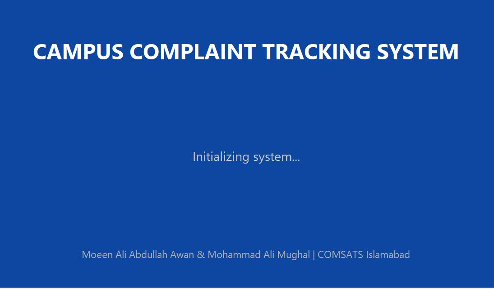

---

### 2. Login Screen
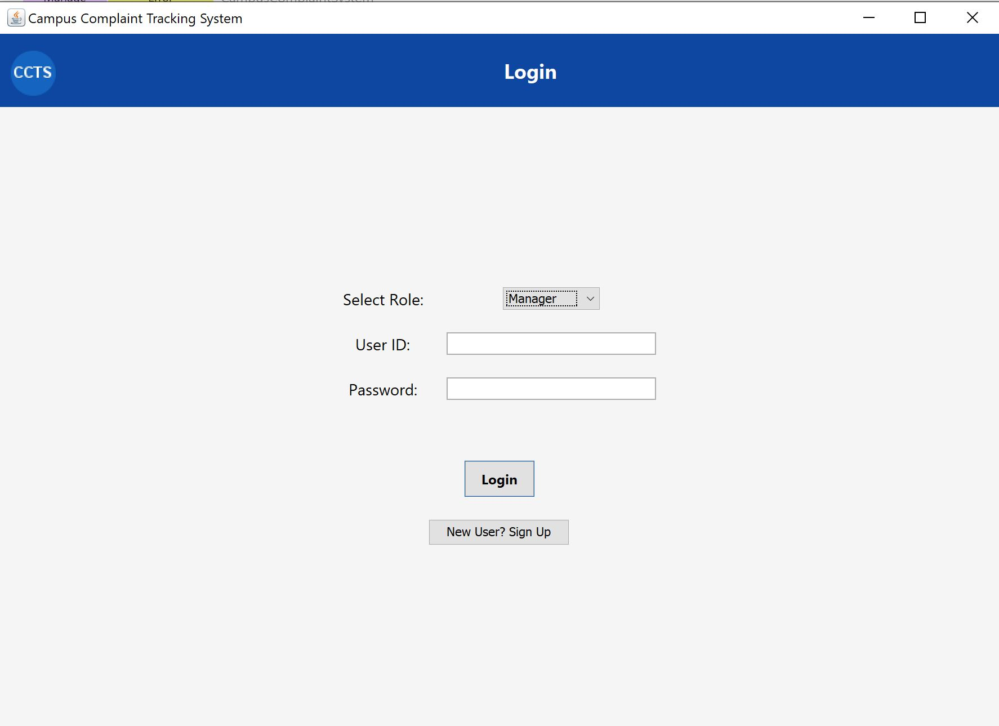

---

### 3. Sign Up (Student/Professor/Staff)
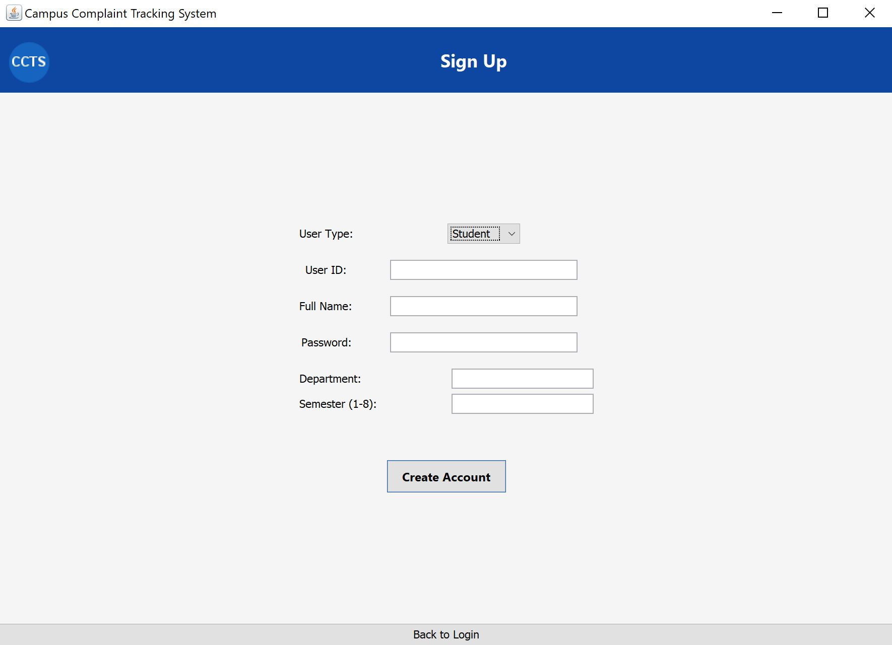

---

### 4. Complainant Dashboard
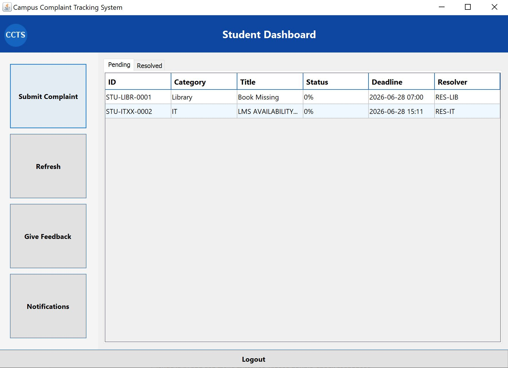

---

### 5. Submit Complaint
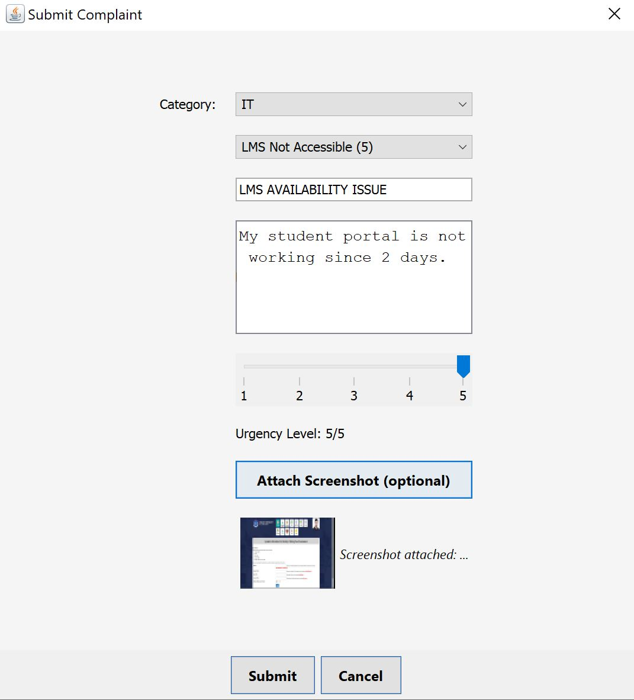

---

### 6. Resolver Dashboard – Active Complaints
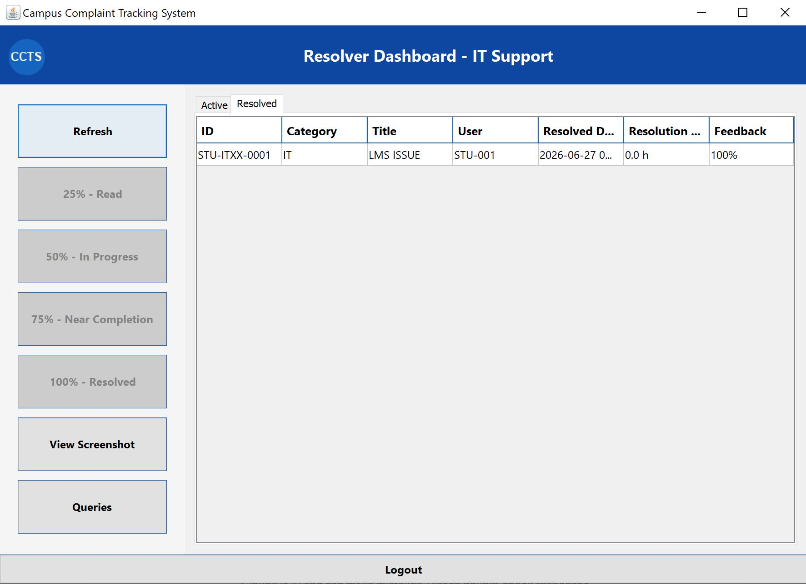

---

### 7. Resolver Dashboard – Resolved Complaints
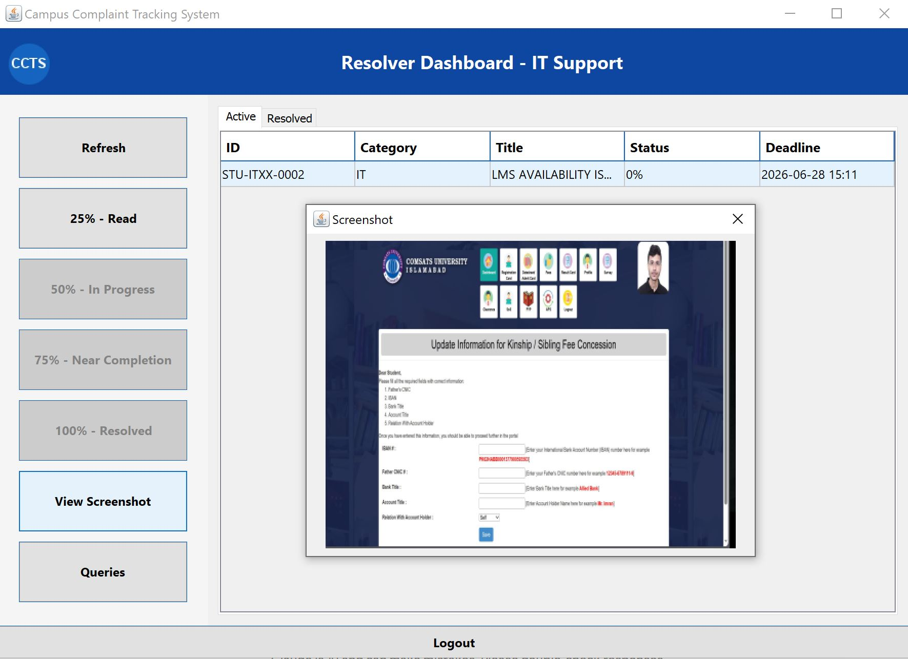

---

### 8. Resolver – Sequential Status Update
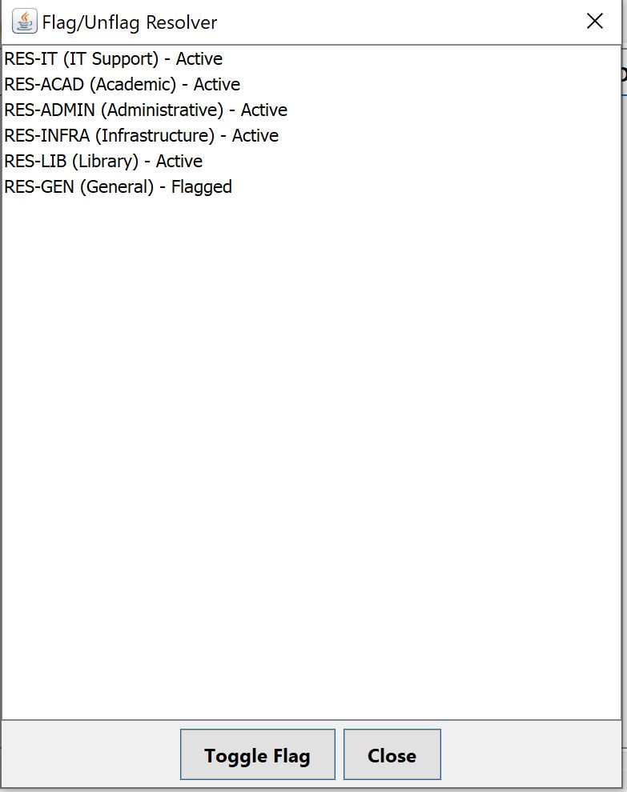

---

### 9. Pending Queries (Resolver)
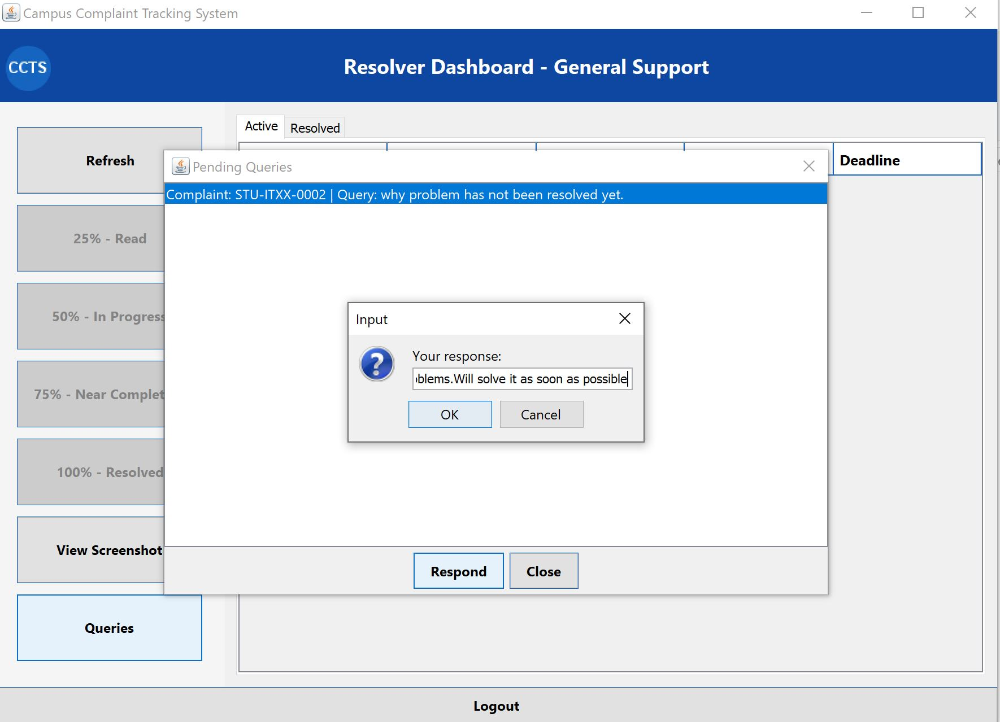

---

### 10. Resolver Responses (Manager View)
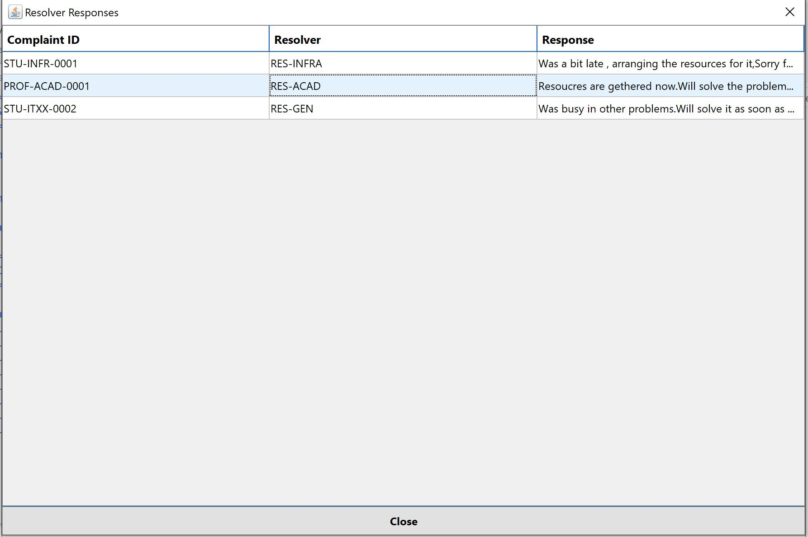

---

### 11. Manager Dashboard – Submitted Tab
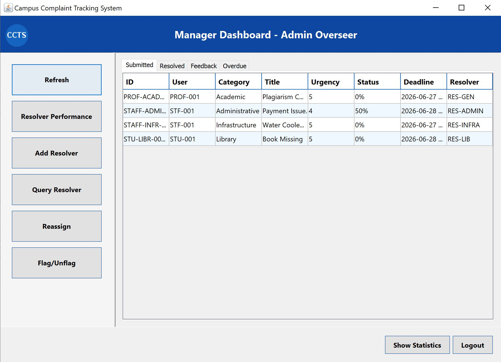

---

### 12. Manager – Complaint Statistics
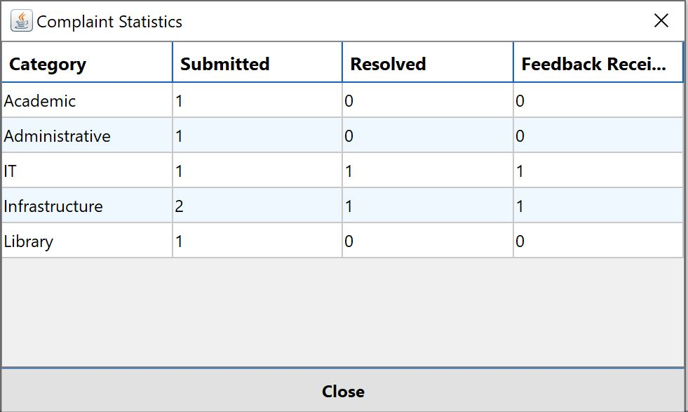

---

### 13. Manager – Resolver Performance
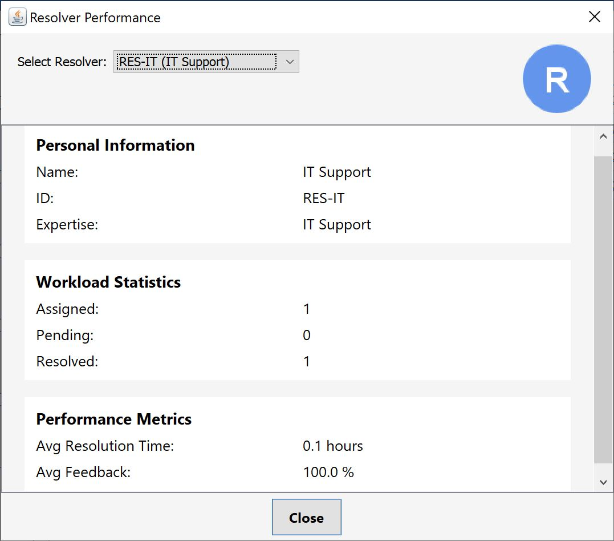

---

### 14. Feedback Dialog
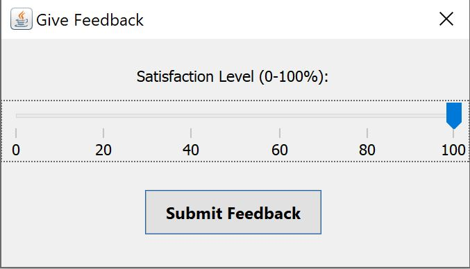

---

## 🔑 Key OOP Concepts Used

| Concept            | Implementation |
|--------------------|----------------|
| **Encapsulation**  | Private fields with public getters/setters in `User`, `Complaint`, etc. |
| **Inheritance**    | `User` abstract base → `Student`, `Professor`, `Staff`, `Manager`, `Resolver`. <br> `ComplaintCategory` → 5 concrete categories. |
| **Polymorphism**   | `IComplaint` interface implemented by `Student`, `Professor`, `Staff`. |
| **Abstraction**    | Abstract classes `User` and `ComplaintCategory`. |
| **Singleton**      | `SessionManager` tracks current logged‑in user. |
| **Utility Class**  | `FileHandler` (static methods for file I/O). |

---

## 📈 Future Enhancements

- Email/SMS notifications for status updates
- MySQL database integration
- Graphical dashboards (charts and graphs)
- Mobile companion app (Android/iOS)

---

## 👨‍💻 Developers

| Name | Registration ID |
|------|----------------|
| **Moeen Ali Abdullah Awan** | FA25-BCS-058 |
| **Mohammad Ali Mughal** | FA25-BCS-059 |

**Course:** CSC241 – Object Oriented Programming   
**University:** COMSATS University Islamabad  
**Semester:** Spring 2026

---

## 📄 License

This project is for academic purposes only.

---

**© 2026 Campus Complaint Tracking System**